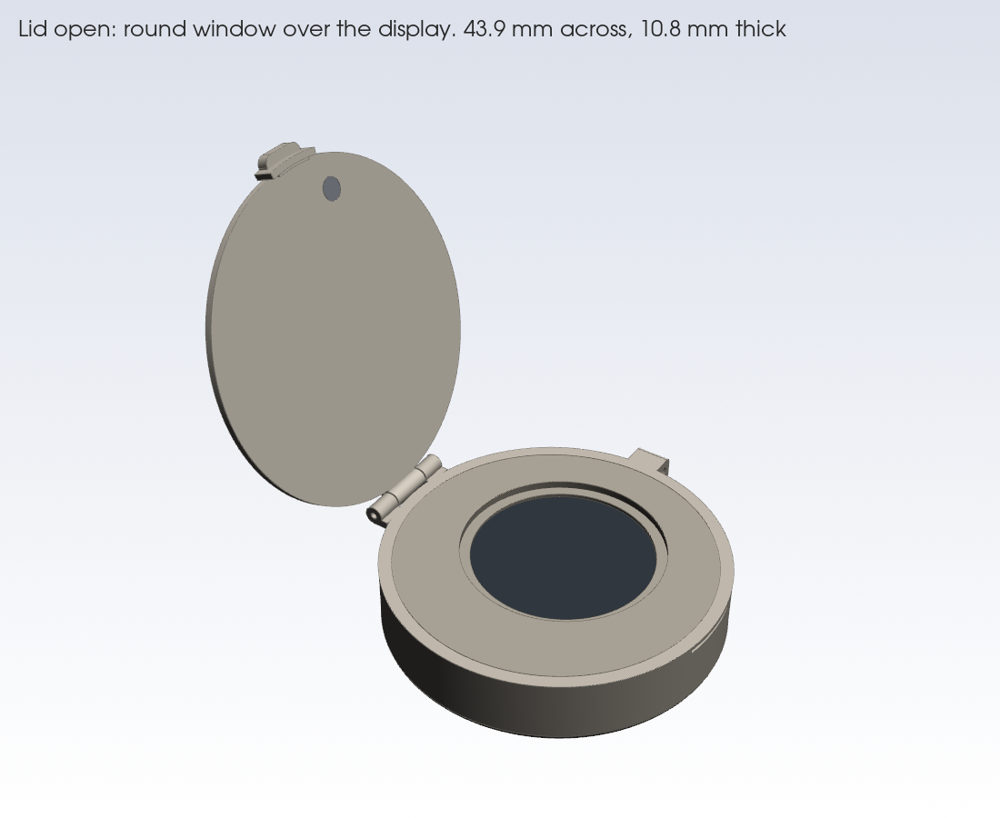
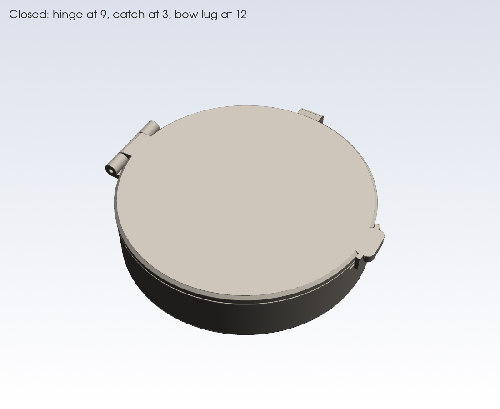
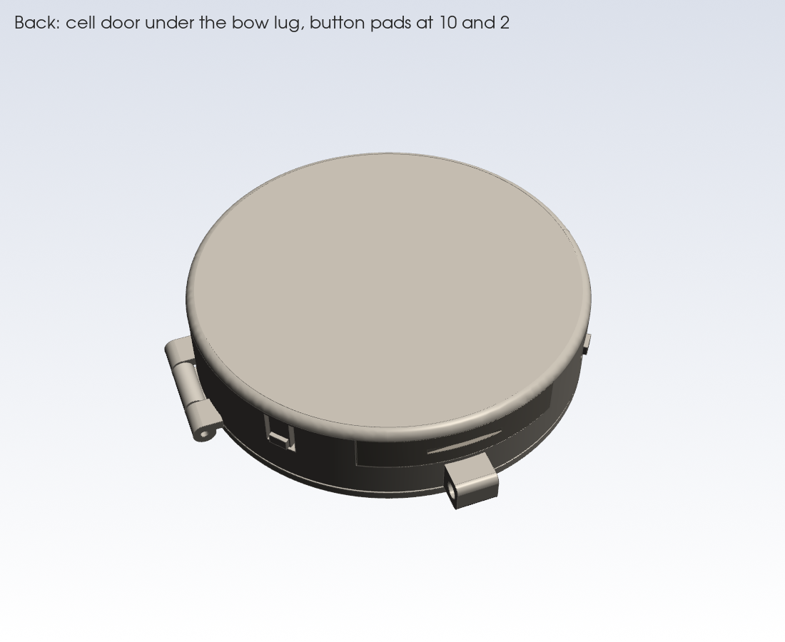
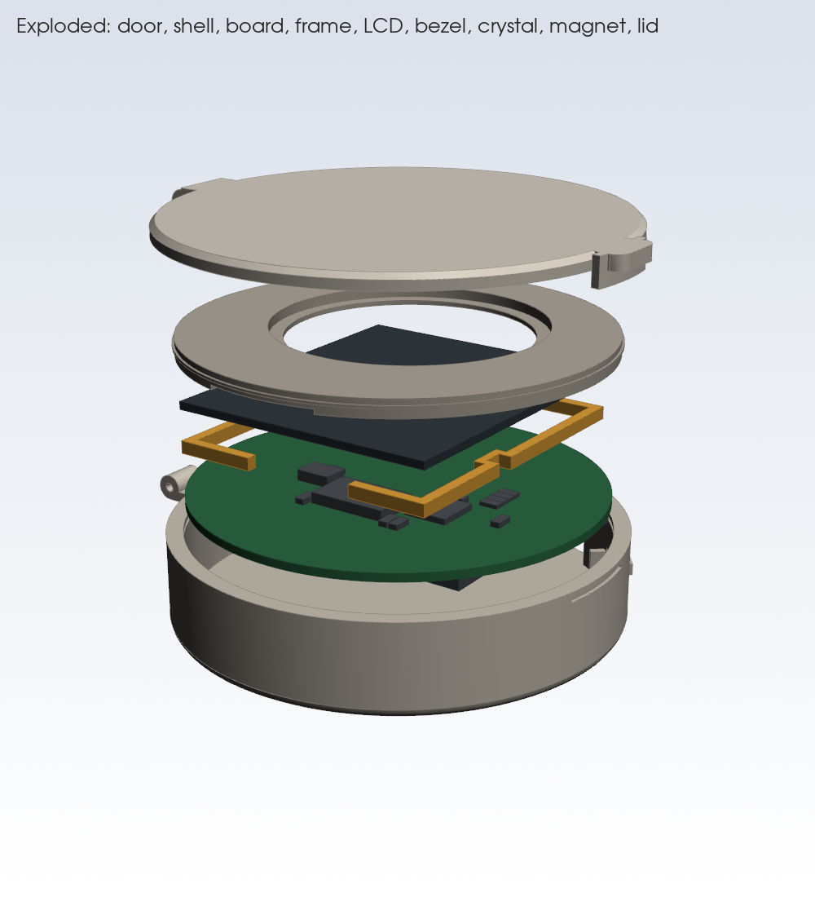
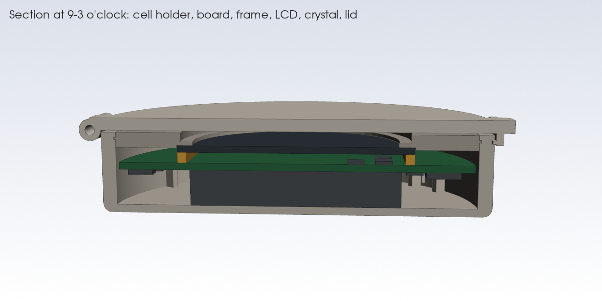

# Case

This is a hunter-style pocket watch case, 3D-printed and modelled around the routed board (`hardware/Eigentime32.kicad_pcb`). It measures **43.9 mm across and 10.8 mm thick with the lid shut** (9.2 mm body and 1.65 mm lid with its gap).

| View | |
|---|---|
|  |  |
|  |  |

## Files

| File | What |
|---|---|
| `eigentime32_case.py` | Parametric CadQuery model. Every dimension is a named constant at the top |
| `fitcheck.py` | Builds the board, parts, LCD, crystal and cell path from the KiCad file and reports any overlap with the case |
| `render.py` | Preview renders (VTK; run headless with `xvfb-run -a`) |
| `stl/` | Printable STL and STEP per part, plus `eigentime32_case.step` (assembly) |
| `renders/` | The images above |

Rebuild: `pip install cadquery`, then `python3 case/eigentime32_case.py case/stl && python3 case/fitcheck.py`.

## Printed parts

| Part | Notes |
|---|---|
| `shell` | Back and middle in one piece. It holds the hinge knuckles, the bow lug at 12, the cell slot at 12, and flexure tabs for the two side buttons. Print it floor-down |
| `bezel` | Holds the crystal and locates the LCD panel in a pocket. It snaps into a groove in the shell bore. Print it top-down |
| `frame` | 1.2 mm spacer under the panel edges, so the glass never rests on parts. It is open at 6 o'clock for the folded ribbon and jogs round C21 |
| `lid` | Hinged at 9, with a snap catch and thumb tab at 3 and a magnet pocket on the underside. Print it top-down |
| `cell_door` | Plugs the cell slot at 12, held by two click bumps. It has a nail slot |

These parts are designed for FDM with a 0.4 mm nozzle (walls ≥ 0.8 mm, flexure slits 0.5 mm). PETG suits the button flexures and the snap fits better than PLA. Resin also works.

## Bought parts

| Part | Spec | Notes |
|---|---|---|
| Watch crystal | Flat mineral glass, Ø26.0 × 1.0 mm | Press it into the bezel from the front, with a dot of UV glue or GS Hypo cement |
| Magnet | N52 disc, Ø3 × 1 mm | Glue it in the lid pocket over U9. The CT8132 trips at 9 G typ (12 G max). This magnet gives about 90 G on axis at 5 mm |
| Hinge pin | Ø1.0 mm steel, ~14 mm long | A cut paper clip works. It is a press fit in the shell knuckles and turns freely in the lid |
| Bow | Jump ring or pocket-watch bow, ≤ 1.6 mm wire | Goes through the 1.8 mm hole in the lug at 12 |

## Assembly

1. Program the board first. The Tag-Connect pads are on the back and are covered once the board is in the shell.
2. Fit the LCD to the board as described in `docs/decisions.md`: the FPC goes into J2 flat with the lever closed, then the panel folds over.
3. Drop the board into the shell, back side down. The cell holder rests on the floor. The ribs beside each button body set the rotation, so each button actuator sits behind its flexure tab.
4. Lay the frame on the board front, then fold the panel down onto the frame.
5. Press the bezel (with the crystal already fitted) into the shell until its rib clicks into the groove. The pocket in the bezel locates the panel.
6. Slide the CR2032 in through the slot at 12, + side towards the back as the holder requires, then click the door in.
7. Fit the lid with the pin, and glue the magnet into its pocket.

To change the cell, pop the door with a fingernail. Push the cell's exposed edge out with a toothpick, then slide the new cell in.

## Check on the first print

- **Button feel:** the nubs sit 0.1 mm off the actuators (`NUB_GAP`). If presses feel mushy or the buttons self-trigger, adjust it.
- **Bezel snap:** the rib interference is 0.15 mm (`RIB_INTERFERENCE`). Tune it for your printer.
- **Lid sensor:** the CT8132's sensing axis isn't stated in the excerpts we have. If the lid doesn't register, move the magnet pocket a couple of mm towards the centre (`U9_XY`). That adds an in-plane field component at the sensor.
- **LCD active area:** the position used (`ACTIVE_CY`, 1.85 mm above centre) is taken from the outline and margins. Check it against Sharp's drawing before printing the bezel.
- **Thickness:** the crystal and its ledge add 1.4 mm. Without the crystal (open aperture, protected only by the lid) the case would be about 9.4 mm.
