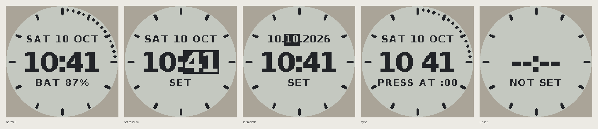

# Firmware

This is bare-metal C for the STM32L031G6, using CMSIS register headers only (no HAL). The build is 17 KB of the 32 KB flash and 4.2 KB of the 8 KB RAM.



*Previews rendered on the host through the 23.4 mm round window: normal, setting the minute, setting the month, button sync, and time not set.*

## Build

```sh
sudo apt install gcc-arm-none-eabi      # or the Arm GNU toolchain
make -C firmware                        # build/eigentime32.elf / .bin / .hex
make -C firmware host                   # host tests + face previews (needs Pillow)
make -C firmware flash                  # OpenOCD + ST-Link over the Tag-Connect TC2030-NL
```

Flash the board **before** it goes in the case. The SWD pads are on the back.

## How it behaves

- **Asleep:** the MCU sits in Stop mode. The RTC runs, CLKOUT is off, the display is unpowered, and the NFC chip is unpowered (the phone can still read it, because it is RF-powered).
- **Lid opens:** the CT8132 edge wakes the MCU. It switches on the display supply and waits for the boost (~0.45 s), then clears and enables the panel. It turns on the RTC's 1 Hz CLKOUT, which drives the LCD's EXTCOMIN, and redraws on the RTC's once-a-second interrupt. Only lines that changed are sent.
- **Lid closes, or 60 s pass without a press:** the MCU powers everything down and goes back to Stop. If the status has changed, or it hasn't been written for 6 h, it rewrites the tag's status link.

### Buttons

| | 10 o'clock (BTN1) | 2 o'clock (BTN2) |
|---|---|---|
| Short press | Show the measured rate (ppm) | Show the battery voltage |
| Long press | Set the time by hand | Sync mode: press again when a reference clock reads :00 |
| While setting | Next field (hour, minute, day, month, year, then save); long press cancels | +1 (hold to repeat) |

### Time sync and drift trimming

- **Phone (Android, Chrome):** tap the watch, and the tag's link opens the [sync page](../docs/sync/index.html). Tap **Sync the watch** and hold the phone to the watch. The page writes `ET32 T=<unix ms> Z=<utc offset min>` as an NDEF text record. The ST25DV's GPO pulses on the RF write and wakes the MCU, which sets the RTC on the next whole second of the phone's clock. It then stores the time zone and rewrites the tag with its status link, which also removes the sync record.
- **Any phone:** hold BTN2 to enter sync mode, then press it when the page's clock, or any reference, reads :00. The watch snaps to the nearest minute.
- **Drift:** each reference sync more than a week after the previous one measures the rate error (`error / time since last sync`). It then moves the RV-3032's aging offset (0.2384 ppm steps, stored in the RTC's EEPROM) to cancel it. A hand-set time is not used as a reference.
- **Cell swap:** the RTC reports a power-on reset, so the face shows `--:--` and `NOT SET` until a sync or a hand set.

The sync page needs GitHub Pages on: Settings → Pages → *Deploy from a branch*, `main`, `/docs`. The tag links to `https://captainchapster.github.io/Eigentime32/sync/` (`src/config.h`).

## Files

| File | What |
|---|---|
| `src/main.c` | State machine: lid, display, buttons, NFC sync, status link |
| `src/board.c` | Pins, EXTI wake-ups, Stop mode, SPI, I2C, VREFINT battery reading, data EEPROM |
| `src/rv3032.c` | RTC: time, 1 Hz CLKOUT, periodic interrupt, aging offset |
| `src/sharp_lcd.c` | LS013B7DH03 power sequence and changed-line updates |
| `src/st25dv.c` | NFC tag memory and GPO setup |
| `src/face.c`, `gfx.c`, `fonts.c` | Watch face (fonts generated by `tools/gen_font.py` from DejaVu) |
| `src/timeutil.c`, `ndef.c`, `logic.c` | Calendar, NDEF build/parse, sync and drift maths, all host-tested |
| `host/` | Host tests and the face preview renderer |
| `vendor/cmsis/` | Arm CMSIS core and ST device headers (Apache-2.0) |

## Check on the first board

None of this has run on hardware yet. Check these first:

1. **RV-3032 registers:** the register bits (status, control, EEPROM commands) were written from the RV-3032-C7 Application Manual's register map. Before the first flash, check them against the manual, and especially the **sign of the aging offset**. The code assumes a positive OFFSET makes the clock run faster.
2. **LCD bit order and command:** the code uses LSB-first SPI, write command `0x01`, clear `0x04`, and line addresses 1–128. Confirm with a test pattern.
3. **ST25DV GPO:** the default GPO configuration and the RF-write pulse. The firmware enables `GPO_EN | RF_WRITE_EN` using the default all-zero I2C password.
4. **Stop-mode current:** measure it with the lid shut. The target is about 1 µA total, of which the MCU's share should be well under 0.5 µA.
5. **Daylight saving:** the watch keeps UTC plus the offset from the last phone sync, so it needs a sync after a DST change.
